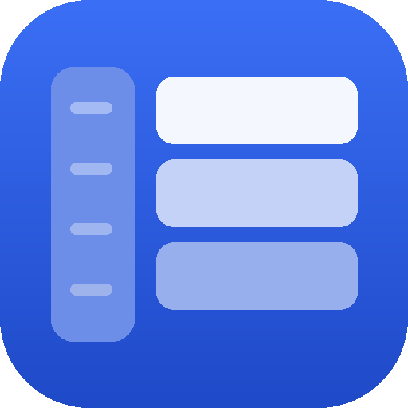
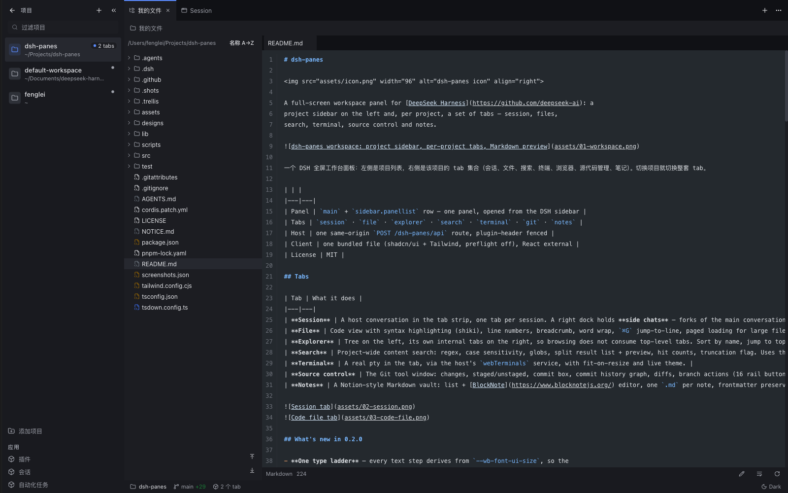
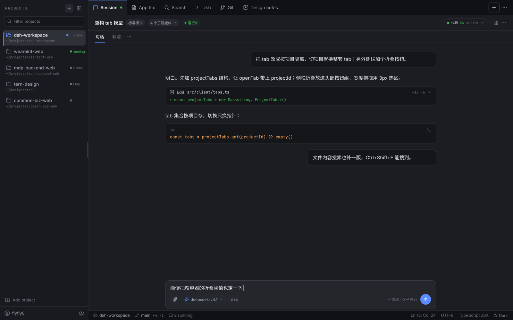
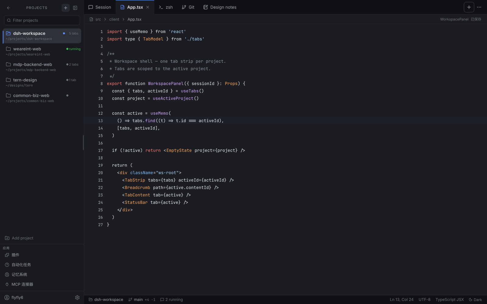
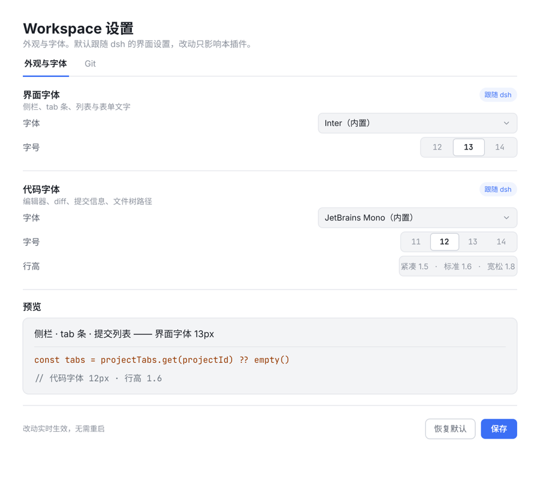
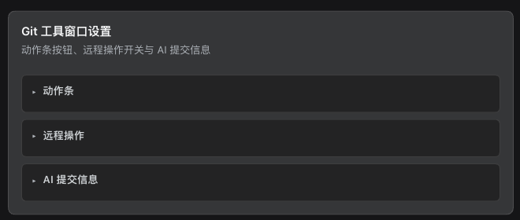
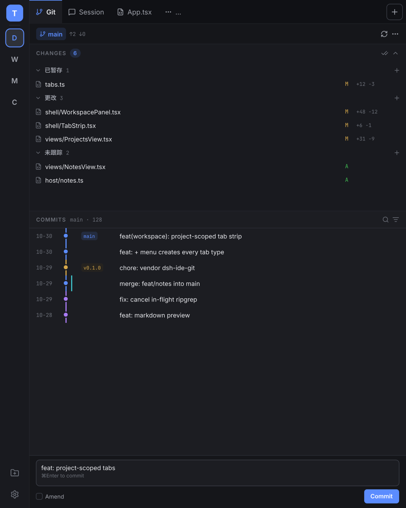

# dsh-panes



A full-screen workspace panel for [DeepSeek Harness](https://github.com/deepseek-ai): a
project sidebar on the left and, per project, a set of tabs — session, files,
search, terminal, source control and notes.



一个 DSH 全屏工作台面板：左侧是项目列表，右侧是该项目的 tab 集合（会话、文件、搜索、终端、浏览器、源代码管理、笔记）。切换项目就切换整套 tab。

| | |
|---|---|
| Panel | `main` + `sidebar.panellist` row — one panel, opened from the DSH sidebar |
| Tabs | `session` · `file` · `explorer` · `search` · `terminal` · `git` · `notes` |
| Host | one same-origin `POST /dsh-panes/api` route, plugin-header fenced |
| Client | one bundled file (shadcn/ui + Tailwind, preflight off), React external |
| License | MIT |

## Tabs

| Tab | What it does |
|---|---|
| **Session** | A host conversation in the tab strip, one tab per session. A right dock holds **side chats** — forks of the main conversation (`⌥S`). |
| **File** | Code view with syntax highlighting (shiki), line numbers, breadcrumb, word wrap, `⌘G` jump-to-line, paged loading for large files, UTF-8 detection — plus an inline editor (`⌘S` saves atomically, with etag conflict detection). |
| **Explorer** | Tree on the left, its own internal tabs on the right, so browsing does not consume top-level tabs. Sort by name, jump to top/bottom, reveal in the system file manager. |
| **Search** | Project-wide content search: regex, case sensitivity, globs, split result list + preview, hit counts, truncation flag. Uses the machine's `rg`, then the `rg` bundled with `@vscode/ripgrep`, then a bounded JS walk — and tells you which engine ran. |
| **Terminal** | A real pty in the tab, via the host's `webTerminals` service, with fit-on-resize and live theme. |
| **Source control** | The Git tool window: changes, staged/unstaged, commit box, commit history graph, diffs, branch actions (16 rail buttons, each switchable), AI-generated commit messages. |
| **Notes** | A Notion-style Markdown vault: list + [BlockNote](https://www.blocknotejs.org/) editor, one `.md` per note, frontmatter preserved by the host, `.trash` on delete, etag-based conflict detection. Notes live in one folder per project (`_inbox` for unassigned ones) and can be moved between projects. |




## What's new in 0.2.0

- **One type ladder** — every text step derives from `--wb-font-ui-size`, so the
  `fontUiSize` config field scales the whole panel (default is one step larger).
  The status bar's light/dark label is now a real toggle.
- **Notes per project** — each project gets its own folder in the vault, the list
  and search are scoped to it, names come from the frontmatter everywhere
  (list, tab, breadcrumb), and notes can move between projects or reveal in Finder.
- **Session tabs behave** — "new session" asks the host for a blank session
  instead of reopening the first one, a history list sits in the `+` menu, the
  tab title follows the session's own title, and the scroll position survives a
  tab switch.
- **Split view** — tabs can be split left/right or top/bottom, moved across panes,
  and the split collapses when its pane empties.
- **Explorer became a split view too**: tree on the left, files in inner tabs on
  the right, with sorting and jump-to-top/bottom buttons.
- **Tab actions** — rename inline (`F2` or double-click), a right-click menu with
  close ranges / copy path / reveal, batch close behind one confirmation, drag
  reorder with a drop marker, and `⌥⌘←/→` to move the active tab.
- **The layout lives in the host** — persisted through the plugin's own route
  (`layout.json` in the DSH home), with localStorage as the cache, so it comes
  back after a port change or cleared site data. `⋯` → reset layout if it ever
  gets stuck.
- **Editable files** — the file tab has an inline editor that saves atomically
  (`⌘S`) and refuses to clobber a file changed on disk (reload or overwrite).
- **Side chats** — fork the current session into a dock on the right (`⌥S`),
  several at a time, each its own conversation.
- **Browser tab removed** — Electron `<webview>` is gated by the host, so the
  iframe could not open most sites; use the system browser.

## Install

```bash
# from npm
dsh plugin --profile web add dsh-panes
```

Then add `"dsh-panes"` to `dsh.profile.bundles` in `~/.dsh/profiles/web/package.json`
and restart the client once — a new bundle is composed into the boot graph only on
restart. After that, rebuilds are picked up by a page reload.

The plugin shows up as the **Workbench / 工作台** row in the DSH sidebar.

From a checkout instead (development):

```bash
pnpm install && pnpm build                     # lib/ is the shipped artifact
dsh plugin --profile desktop add "$(pwd)"      # pnpm link
# add "dsh-panes" to dsh.profile.bundles, restart
```

Uninstall: remove it from `dsh.profile.bundles`, then
`dsh plugin --profile web remove dsh-panes`.

## Using it

- The sidebar lists every workspace with its open-tab count. `+` adds a project; the filter box narrows the
  list; the collapse button shrinks the sidebar to a 52px rail (automatic below
  820px of panel width).
- `+` at the top right opens the **NEW TAB** menu: new session, open file,
  explorer, search, terminal, git, notes — then the project's recent sessions.
- Tabs can be split into two panes (side by side or stacked) from the `⋯` menu;
  each pane keeps its own strip, and a tab moves between panes from the same
  menu. Double-click a tab to rename it, right-click for close-range, copy path
  and reveal; drag to reorder.
- Tabs are scoped to the project: switching project switches the whole tab set.
  Each project's layout is persisted (in the host profile, so it survives a
  port change or cleared site data).
- The status bar shows branch + changed-file count (`±n`, click opens Git), the
  project's open-tab count, cursor line/column, encoding, language, and a
  light/dark toggle.

Keyboard (the panel only — a focused editor or terminal keeps its own keys):

| Keys | Action |
|---|---|
| `⌘P` / `Ctrl+P` | Quick open a file by name |
| `⌘⇧F` / `Ctrl+Shift+F` | Project search |
| `⌘⇧N` | New session tab |
| `⌘W` | Close the current tab |
| `⌘⇧T` | Reopen the last closed tab |
| `⌘B` | Collapse / expand the project sidebar |
| `Tab` / `⇧Tab` | Cycle tabs |
| `F2` | Rename the focused tab |
| `⇧F10` | Tab context menu |
| `⌥⌘←` / `⌥⌘→` | Move the tab left / right |
| `←` / `→` | Move focus between tabs |
| `⌥S` | Toggle the side-chat dock (session tabs) |
| `Esc` | Close the panel |

Per view: `⌘G` jump to line (file), `⌘⇧V` preview/source (Markdown), `⌘S` save (note).

## Settings

Plugins → **dsh-panes**. Every field is live — no restart.



| Field | Meaning |
|---|---|
| `startup` | `workspace` (default) · `last` (only if the workbench was the last panel) · `conversation` |
| `fontUiFamily` / `fontUiSize` | UI font stack / size (px); empty = follow dsh |
| `fontCodeFamily` / `fontCodeSize` / `fontCodeLineHeight` | code font stack, size, line height |
| `notesVaultPath` | absolute notes directory; empty = `$DSH_HOME/notes` (an Obsidian vault works) |
| `experimentalRemoteOps` | shows and allows push / pull (default off) |
| `commitModel` / `commitReasoning` / `commitPrompt` | AI commit message model, reasoning strength, extra prompt |
| `rail*` | one switch per Git action-rail button (16 of them) |




## How it is built

The package is a Cordis plugin with two halves, mounted by a bundle patch:

| Path | Role |
|---|---|
| `src/index.ts` | Host half: the Cordis plugin, `POST /dsh-panes/api` route, `Config` schema. |
| `src/client.tsx` | Browser half: registers the `main` panel and its `sidebar.panellist` row. |
| `src/panel/` | Panel shell, file/explorer/search/Markdown/terminal views, shared types. |
| `src/tabs.ts` | Pure tab model: per-project tab sets, idempotent open, persisted layout. |
| `src/notes.ts`, `src/notes/` | Notes vault (host ops) and the list + BlockNote editor. |
| `src/git/` | Forked Git tool window (`host.js`, `panel.js`, adapter); see `src/git/UPSTREAM.md` for provenance. |
| `src/ui/` | shadcn primitives (button, input, dropdown-menu) + `cn()`. |
| `src/styles/tailwind.css` | Design tokens (host theme vars) + Tailwind layers. |
| `cordis.patch.yml` | Bundle patch: one `insert` row naming this package. |

Two registrations are needed for one panel: `main` holds the content and
`sidebar.panellist` (same id as the panel key) holds the sidebar row, its label
and its icon. Registering `main` alone shows nothing.

Host calls go through the single same-origin route with `{ op, args }`; the
client must send `x-dsh-plugin: dsh-panes`, and the host answers only loopback or
same-origin callers.

Tailwind runs with **preflight off** and every component lives under
`.workbench-root` / `.workbench-portal`, so the panel cannot restyle the host.
Only `react`, `react-dom` and `@deepseek-ai/*` stay external; everything else is
bundled into `lib/client.js` (compiled to CJS and wrapped into the client-modules
factory form by `scripts/wrap-client.mjs`).

## Development

```bash
pnpm install
pnpm build       # build:styles (Tailwind -> src/generated/styles.ts) + tsdown + wrap
pnpm typecheck   # tsc --noEmit
pnpm test        # node --test: host route, tab model, search, notes, git guards
pnpm check       # build + typecheck + test
```

Rebuild and reload the page to pick up client changes; a bundle added to a
profile needs a client restart.

## Known limits

- **The code editor is plain**: a textarea with save and conflict detection —
  no syntax highlighting while editing, no completion, no LSP, and closing the
  tab does not prompt about unsaved changes.
- **Side chats are read-only mirrors**: the client can read a session's events
  but has no composer write entry, so quoting a selection back into the fork is
  not implemented. A fork also needs a completed turn to split from, so a brand
  new session cannot be forked yet.
- **Search and notes act on client-supplied absolute paths**, fenced by the
  plugin header + same-origin check rather than by "must be inside a registered
  workspace" (the host exposes no workspace list to the host half). Treat the
  route as trusted-page-only, the way `/api` is.
- **Git push / pull stay hidden by default**: the buttons are absent until
  `experimentalRemoteOps` is on, and the host refuses those methods while it is
  off. No credential, proxy or conflict handling is claimed for them.
- The Git panel is a fork of `dsh-ide-git` v0.21.1 (MIT), pinned here and no
  longer synced with upstream; it still carries its own `dig-` styling.
- The Git status bar calls `summary` with `stats: false` — it shows `±n` changed
  files, not added/removed line counts.
- There is no in-app browser tab: Electron `<webview>` is gated by the host, and an
  `iframe` cannot open most sites. Use the system browser.
- Notes: a symlink inside the vault is refused (`lstat`), so a note can never be
  a link to a file outside the vault — read *or* write.
- The browser bundle is a single ~9.4 MB file (≈2.1 MB gzip), most of it
  BlockNote. The editor is loaded lazily so a failure in it costs one tab, not
  the panel's boot — it does not save download time.

## Credits

The Git tool window is forked from `dsh-ide-git` v0.21.1 (MIT); its license and
the exact list of local hunks live in `src/git/LICENSE` and `src/git/UPSTREAM.md`.
The design language follows DSH's own panel tokens.

MIT © flyfly6
